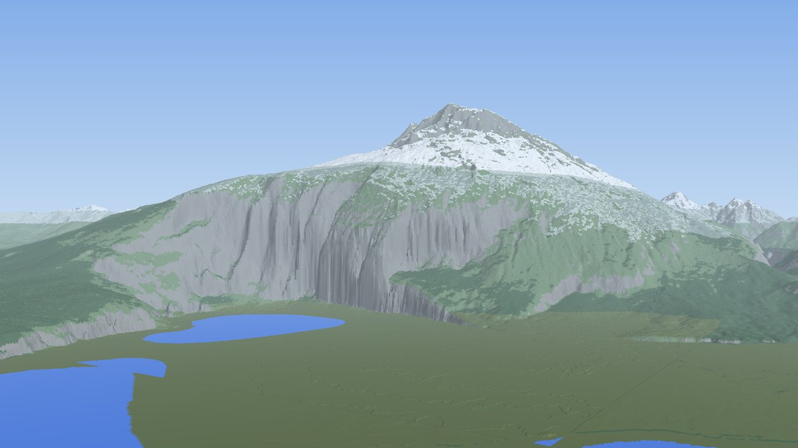

# Terrain Diffusion seed finder

Tools for finding seeds and coordinates with specific landforms in the
[Terrain Diffusion](https://github.com/xandergos/terrain-diffusion-mc) Minecraft mod, without
running Minecraft. Built to answer one request: a giant mountain with a very steep drop, a very
high peak and a lake at its foot, at World Scale 6.

**Result:** seed `3375007`, World Scale 6. Peak at X 99051, Z −37707, Y 1305; a 10 km² sea-level
lake centred at X 99293, Z −35657; 1,242 blocks of relief, including a 636-block drop inside one
200 × 200-block area. `/tp @s 99355 65 -35130 173.3 -14.0` looks at it from the lake shore.



Other verified sites are in `results/*/info.json` (6463007, 6628007, 38007, 827007, 3408007).
The images are renders of the generated heights, not screenshots.

## How the mod generates terrain

The world is a deterministic function of the seed, computed lazily in three stages:

1. **Coarse** (7.7 km/pixel): a small diffusion model, 20 solver steps per 64 × 64 tile, conditioned on
   a Perlin map. Outputs mean elevation, 5th-percentile elevation and climate.
2. **Latent** (240 m): a large model, two steps per tile, conditioned on the coarse map.
3. **Decoder** (30 m): one step per 256 × 256 tile.

Blocks are the 30 m heights upsampled by the world scale (scale 6 = 5 m per block). Water exists
only where elevation is below zero; there are no rivers or lakes above sea level.

## Techniques

- **Ground truth harness** (`harness/`). The mod's own pipeline classes, compiled headlessly with
  three small stand-ins for the Fabric-only classes. Every reported coordinate comes from this.
- **Exact batched port** (`tdsearch/pipeline.py`). numpy + onnxruntime reimplementation of all three
  stages, including the mod's PCG noise and Perlin conditioning. On CPU it matches the harness to
  0.003 m (`python -m tdsearch.selftest` checks this); on CUDA, block heights agree within ±1 block.
- **Two-level funnel** (`tdsearch/worker.py`):
  1. *Coarse scan.* Per seed, 36 tiles around the origin. Only each tile's inner 32 × 32 is scored,
     because there the tile alone determines the mod's blended map, so the values are exact.
     A candidate is a pixel containing sea-level water (5th percentile < 0) next to very high ground.
  2. *Refine.* Generate the real 30 m terrain in a 38 km window around each candidate and score it.
- **Scoring** (`tdsearch/analyze.py`). A lake is a wide below-sea-level body that does not reach the
  window edge. Its score is the best `elevation × sqrt(min(1, elevation / distance from shore))`
  over the surrounding land, adjusted for lake size, depth, enclosure and attached narrow channels.
- **Review and verification.** `review.py` ranks sites and builds contact sheets; the top few are
  regenerated block-by-block through the harness, and `finalize.py` turns that into coordinates,
  `/tp` commands and previews. `biome_map.py` and `shots.py` render maps and camera previews.

## Numbers

| | |
|---|---|
| Seeds scanned / sites refined / with a lake | about 2,100 / 782 / 161 |
| Throughput, one RTX 3090 | 30–37 coarse tiles/s; about 3.5 s per refined site; about 2.3 s per seed overall |
| GPU cost of the whole search | about $0.70, estimated from hours × rates (four rented GPUs, about an hour) |
| CUDA port vs mod on CPU, six sites | over 99.999% of blocks within ±1 (73–90% identical); water outline 98.7–99.6% identical |

Speedups that were measured and did not pay off:

| Idea | Measurement |
|---|---|
| Perlin-map prefilter before the coarse model | 64,800 tiles: keeping 90% of good tiles still means running 73–82% of all tiles |
| Early exit from the 20-step sampler | preview/final score correlation 0.41 at step 5, 0.65 at step 10 (216 tiles, only 3 positives: underpowered) |
| Ranker on 9 coarse summary features | cross-validated AUC 0.71; refining the top 25% keeps about half the lakes |
| fp16 coarse model | ONNX conversion failed on mixed-type nodes; not pursued |

The coarse candidate score itself predicts the refined score poorly (correlation 0.15), and only
about 15% of refined sites contain a lake, so most refinement work is wasted.

## Improvement directions

1. **Score the blended tile overlaps.** The full 6 × 6 grid is already computed; blending it would
   double the exactly-known coarse area per seed for free.
2. **Screen at 240 m before decoding.** The decoder is about half the refinement cost and a lake is
   visible in the latent elevation channel. Decode only the hits, and start with a smaller window.
3. **Better candidate ranking.** Train on the coarse patch around each candidate, not nine summary
   numbers, using the existing 782 labelled refinements; lake presence is the label that matters.
4. **Deeper staged filtering** in the style of [COMMISSION](https://github.com/MinecraftAtHome/COMMISSION):
   loose necessary-condition gates after a few solver steps, with compaction between stages.
   Unlike Perlin octaves, the diffusion stages have no hard bounds, so the gates must be learned
   and re-tested at scale.
5. **Half precision or TensorRT** for screening passes only; exact fp32 stays for verification.
6. **One-step distilled student** of the coarse sampler for screening. Capped below 2× overall
   until refinement is also cheaper, since the coarse scan is half the per-seed cost.
7. **Rivers.** Narrow below-sea-level channels almost never appear (the best sites have fjord arms
   or ribbon lakes instead). A dedicated criterion, or targeting a fork that adds rivers, is needed.
8. **Verification gaps.** The DirectML (Windows) and CUDA builds of the mod were not tested, and
   in-game agreement was only checked by navigating to the summit, not block by block.

## Usage

Needs Python 3.10–3.12, JDK 21, git and curl. Run everything from the repository root.

```bash
python -m venv .venv && source .venv/bin/activate && pip install -r requirements.txt
scripts/fetch_models.sh                      # 2.3 GB of ONNX models, pinned revision
harness/build.sh                             # fetches the mod at v2.2.0 and compiles the harness
python -m tdsearch.selftest                  # port vs mod, CPU, about 20 s

python -m tdsearch.worker prod/local 0 600   # scan + refine seeds 1000*k+7, k in [0, 600); wants a GPU
python -m tdsearch.review --top 20 --sheet work/sheet.png

# verify a site through the mod's code and get coordinates (block bounds are multiples of 256)
harness/run.sh blocks 3375007 6 -38400 97280 -34816 100864 work/blocks_3375007.bin
python -m tdsearch.crop 3375007 -24 64 work/crop_3375007.npy
python -m tdsearch.finalize seed3375007 3375007 -38400 97280 -34816 100864 \
    work/blocks_3375007.bin work/crop_3375007.npy -6656 15872 -35690 99258
python -m tdsearch.shots results/seed3375007/shots.json
```

On a rented CUDA box: `scripts/hpush.sh ip:port`, then run `scripts/gpu_box_setup.sh` there.
`scripts/collect.sh` pulls results from the boxes listed in `hosts.txt`.

Coordinates: pipeline row `i` is Minecraft Z and column `j` is X; block = 30 m pixel × scale;
`Y = floor(metres / 5) + 63` at scale 6. A numeric world seed is used as-is.

## Layout

```
harness/      build.sh, run.sh, stubs/ (stand-ins + Harness.java driver)
tdsearch/     pipeline, rng, synth, blocks (the port); worker, scan_coarse, refine, select_cands (search);
              analyze, review, finalize (scoring, ranking, coordinates); render, shots, biome_map (previews)
experiments/  the prefilter, early-exit and ranker tests behind the table above (python -m experiments.NAME)
scripts/      model download, GPU box setup, multi-box helpers
results/      info.json per verified site; shot spec for seed 3375007
```

The mod (MIT-licensed) and its models are by Alexander Goslin; both are downloaded at build time, not included here.
